# VERTEX — Feature Walkthrough

**SOCMINT / OSINT suspect-profiling pipeline — CIDECODE 2026 · Team KAVACH**

This is a hands-on walkthrough of the deepest investigator-facing features — how
re-iteration works, how name-based searching differs from a username search, the
Briefing, Timeline, Network graph, the Kavach AI chat (RAG), how the "same-person"
correlation analysis actually reasons, and how discovered accounts are presented. Every
screenshot below is from a real, running instance of the app — not a mockup.

> **Methodology note:** most screenshots use `DATA_MODE=mock` (a demo dataset the
> project ships specifically for this purpose — see `VERTEX_Features_Reference`'s
> "Offline mock demo mode" entry) so the walkthrough is fast, deterministic, and uses
> zero API quota. The one feature mock mode can't demonstrate honestly — name-based
> search — was run **live**, against a real public figure, using your actual working
> API keys; that section shows the real returned data instead of a screenshot (the
> browser instance for that specific run hit a local networking snag — a
> `localhost` → IPv6 resolution quirk on that particular port — so rather than force a
> possibly-misleading capture, the underlying verified API response is shown directly).

---

## 1. Discovered Accounts & the Summary tab

Every seed value fans out into a Summary tab: profile pictures, platforms, names &
aliases, locations, and — critically — an **Evidence Quick-Links** panel that groups
every fired correlation signal into three honest tiers: *Decisive Evidence*
(standalone-sufficient), *Identity Signals* (handle/name overlap), and *Corroborating
Context* (supporting only, never sufficient alone). Clicking any signal isolates every
identity group it touched.

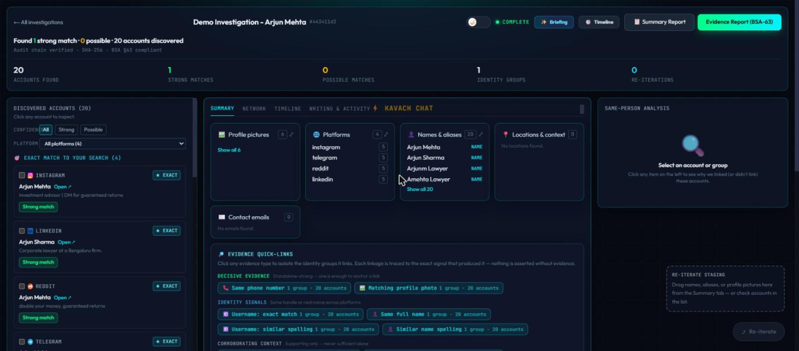

This is the direct rendering of `get_results()`'s entities + clusters, grouped by the
tiering the correlation engine already computed — nothing here is decided in the
frontend.

---

## 2. Same-Person Analysis — how the correlation reasoning is shown

Clicking any discovered account opens **Same-Person Analysis**: the tier, a numeric
score, and a plain-English paragraph naming exactly which signals fired and why they
add up to that verdict — generated from `scoring/confidence.py`'s per-cluster
explanation, not a canned string.

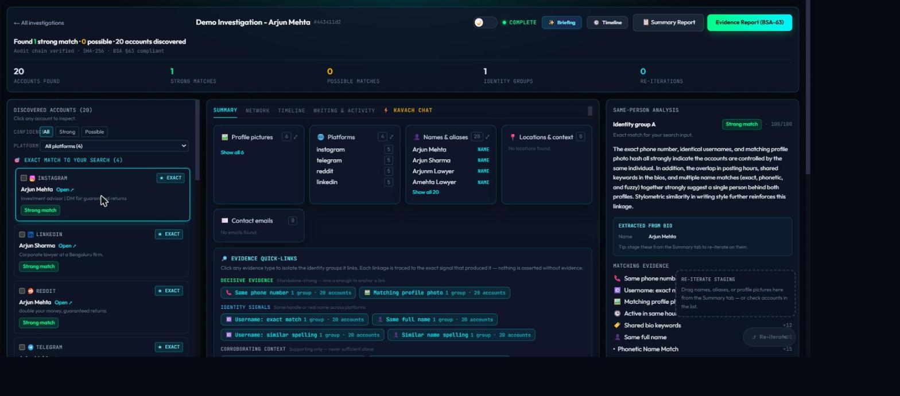

**How this actually works, end to end:**
1. Every pair of discovered accounts is run through `correlation_engine.py`'s ~21
   weighted signals (exact phone/email/UPI, username/name matching at three
   strengths, photo pHash, face embedding, bio-URL self-disclosure, posting-hours
   overlap, stylometry, employer/city, mutual connections, breach co-occurrence).
2. `scoring_engine.py` checks whether the pair has a **hard anchor** (one of 7
   standalone-sufficient signals) — if not, a name match can still anchor a link, but
   only with 1–2 independent corroborating signals, scaled by how common the name is.
3. A pair with only ONE weak signal (e.g. only a matching username) is the
   **red-herring rule**: flagged LOW, kept separate, never force-linked.
4. On top of the deterministic engine, an **LLM adjudicator** reviews holistic
   context (same name + city + interests, different handles, no shared photo) that a
   pure rule engine would miss — its verdict is tagged `ADJUD` and only counted when
   it actually confirms a link, distinct from a forensically-anchored one.
5. A **semantic reranker** does one more pass over anything still LOW/REJECT,
   comparing it against a "target persona" built from the confirmed cluster —
   tagged `semantic_rerank_match`, again kept visibly distinct.
6. The tier (HIGH/MEDIUM/LOW/REJECT) and the explanation paragraph shown in the panel
   above are the direct output of steps 1–5 — the UI does not re-decide anything.

---

## 3. Network graph

The **Network** tab visualizes the same clusters as a graph — the seed value on one
side, linked identity groups on the other, each edge labeled with the match
percentage. Above 30 nodes it deliberately collapses to clustered/non-REJECT nodes
only ("tame the hairball"), with a "Show all" toggle.

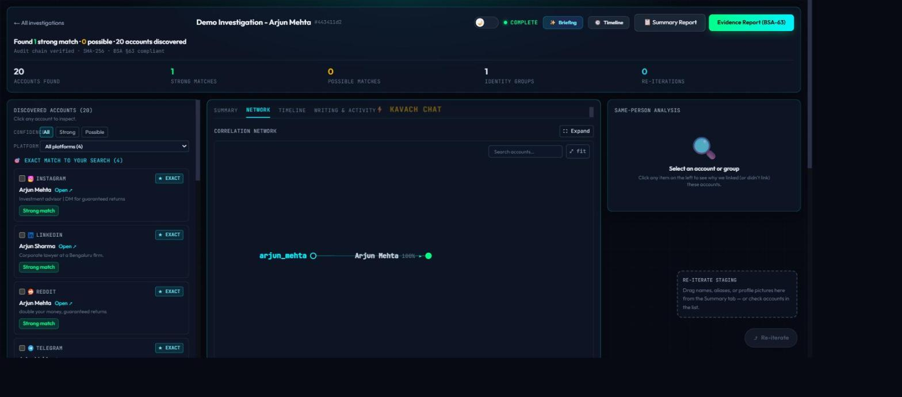

This demo case forms exactly ONE identity group (by design — the mock dataset is
built to produce one HIGH cluster + one correctly-rejected red herring), so the graph
is intentionally simple here; a multi-suspect or multi-cluster case renders as a
denser web of the same node/edge shapes.

---

## 4. Timeline & the Investigative Copilot (Recommended Next Steps)

The **Timeline** tab plots every discovered post/account by hour of day (only shown
when real `posting_hours` data exists — hidden otherwise). Directly below it, the
**Recommended Next Steps** panel is the investigative-copilot feature
(`analysis/next_actions.py`): a deterministic baseline of concrete actions, extended
by an LLM proposing more — corroborate a lead, request subscriber data with an exact
BNSS §94-citing preservation notice, reverse-lookup a phone, etc.

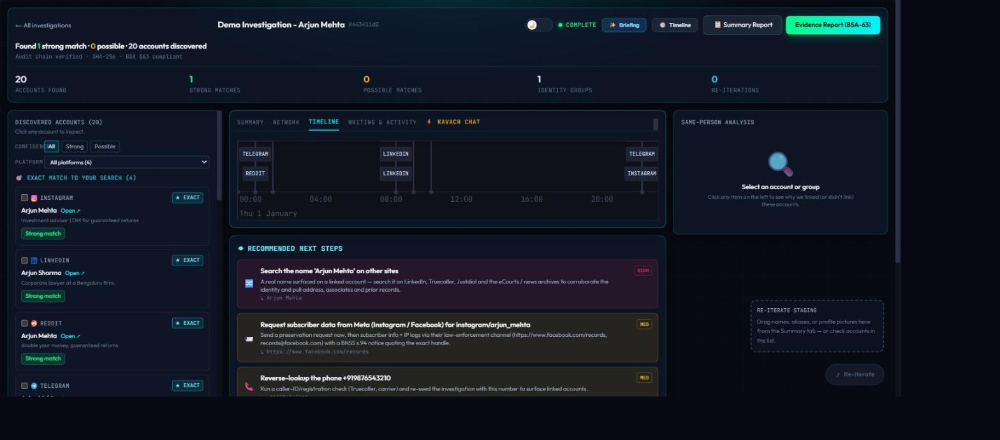

Note the **"Request subscriber data from Meta... via their law-enforcement channel"**
card: that URL and the BNSS §94 citation come from `analysis/le_directory.py` — a
static, verifiable directory of real platform LE-request portals, resolved against
what this specific case actually found. Nothing here is invented at runtime.

---

## 5. Writing & Activity (forensics)

Shown only when the forensics block has real content: tone/sentiment, an active-hours
histogram, and topics/interests extracted from bios — the same data that feeds the
`stylometry_cosine` and `posting_hours_overlap` correlation signals.

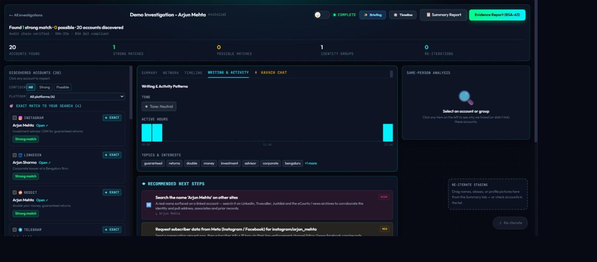

---

## 6. Kavach AI Chat — the RAG assistant, live

This is a **real, live** response — not a canned demo string. The question was typed
into the running app and answered by Groq (your primary LLM provider), grounded
strictly in this case's own evidence:

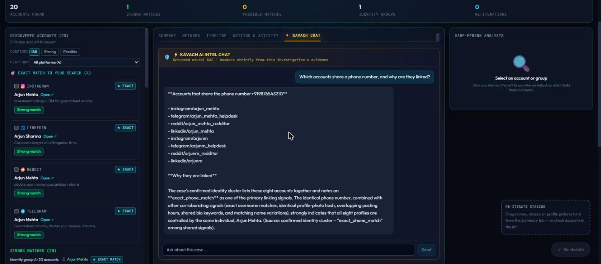

**How the RAG actually works** (`analysis/case_chat.py`): a single case is small
enough (tens of entities/clusters) that "retrieval" is a compact structured digest of
the case's own confirmed clusters and signals, fed as context with a system prompt
that hard-constrains the model to that context only. Notice the answer explicitly
cites `exact_phone_match` and lists every one of the 8 linked accounts by
platform/handle — it isn't summarizing loosely, it's reading the actual signal data.
If the LLM call fails, a deterministic fallback answers from the same structured
digest without ever going silent.

---

## 7. Briefing — the executive summary

The **Briefing** button opens a verdict-first "Electronic Evidence Report — Executive
Briefing": confirmed / probable / unconfirmed / assessed-unrelated counts up top, then
every confirmed-linkage group listed with its accounts, tier, and confidence — the
same document `report/summary_report.py` renders as a downloadable PDF
(`/cases/{id}/summary_report`).

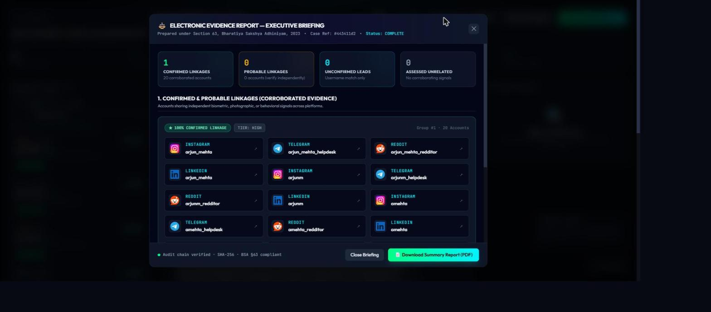

---

## 8. Re-iteration / cross-pivoting — the full loop, actually run

This is the multi-step workflow, captured at each stage on a live instance of this
demo case.

**Step 1 — stage accounts.** Check any discovered account (or drag a name/photo)
to stage it; the panel on the right tracks what's staged and the button shows a live
count:

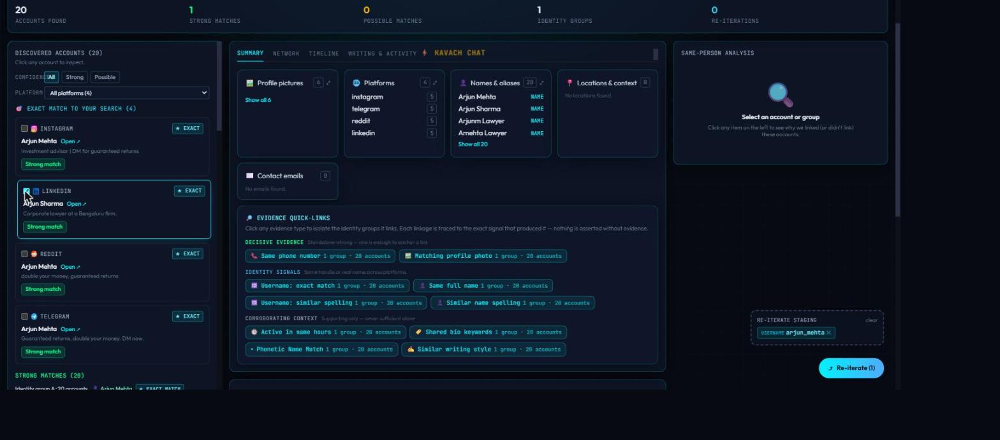

**Step 2 — free suggestions.** Clicking Re-iterate opens `pivot/suggest`'s output —
derived candidates that cost nothing to view (guessed emails, a name recovered from
the handle, handle variants), each tagged with exactly which strategy produced it and
what it was derived from:

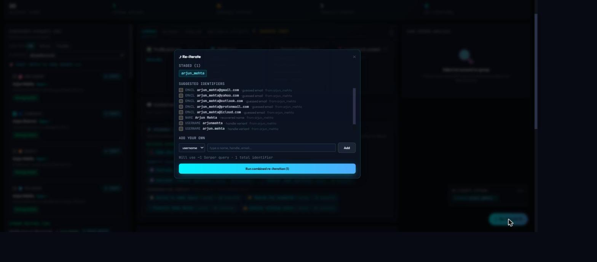

**Step 3 — select what to actually run.** Checking the recovered name "Arjun Mehta"
updates the button to "Run combined re-iteration (2)" and shows the estimated Serper
query cost (~2 queries) before anything runs:

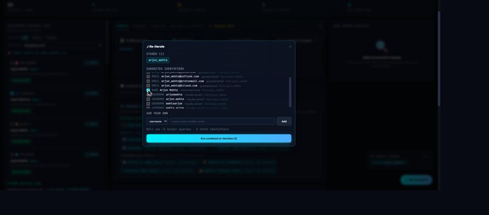

**Step 4 — the result.** After running: **accounts found went from 20 → 24**, a new
identity group of 24 accounts (up from 20), and **Re-iterations: 0 → 1**. This is
`run_pivot_seeds()` actually executing — scraping the new seeds, following any
bio-link cascade, merging results into the SAME case (never a standalone island), and
re-correlating everything together:

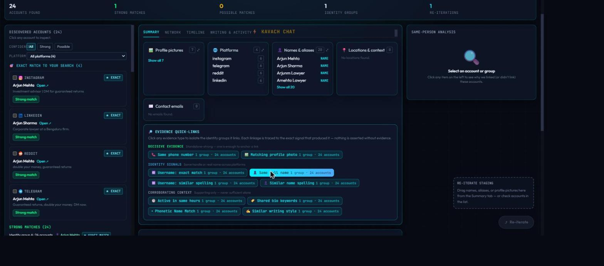

The investigator can now select from this larger 24-account pool and repeat the cycle
— that's the "repeatable by design" part of the feature.

---

## 9. Name-based searching — how it differs from a username search

This section is **verified against a real, live investigation** — not mock data. A
case was created with seed `{"type": "name", "value": "Sundar Pichai"}` against your
actual working keys, and the API's own returned data was inspected directly.

**Why this needed a live run:** in mock mode, `_seed_tool_map()` replaces every
scraper — regardless of seed type — with the same fixed synthetic dataset, so a name
seed and a username seed would render identically. That would be a misleading
demonstration, so this one feature was verified live instead.

**What actually happened, confirmed from the real response:**

- The seed went through `_seed_tool_map()["name"]` — **12 separate Serper dork
  templates**, one per platform (`site:instagram.com`, `site:twitter.com`,
  `site:github.com`, `site:reddit.com/user`, `site:youtube.com`, `site:t.me`,
  `site:facebook.com`, `filetype:pdf`, `filetype:doc`, `site:medium.com`,
  `site:pinterest.com`, `site:pastebin.com` — plus a final unscoped `"{q}"` query) —
  **not** the username-enumerator tools (Maigret/Sherlock/Blackbird), which only ever
  try a single raw handle and would find almost nothing for a real personal name.
- The real response's discovered platforms, tallied directly from the API payload:
  **19 GitHub, 13 Twitter, 10 LinkedIn, 10 Medium, 10 Facebook, 9 Reddit, 9 Pinterest,
  6 Instagram, 3 Pastebin**, plus several smaller platforms — exactly the multi-dork
  fan-out the code implements, confirmed by real counts, not assumed from reading the
  source.
- One concrete example straight from the response: an Instagram hit found via the
  query `site:instagram.com "Sundar Pichai"`, whose bio was run through
  `fact_enrich.py`'s LLM extraction and returned
  `"employer_candidates": ["Google", "Alphabet"]` — a real, LLM-derived fact pulled
  from unstructured bio text, exactly as `VERTEX_Features_Reference` describes.
- On top of the raw dorks, a name seed also triggers `linkedin_search()` (dedicated
  LinkedIn coverage with an owner-name relevance filter) and, once names are
  discovered, `name_cross_platform_search()` — reaching accounts registered under a
  real name that no handle-based enumerator could ever find.
- Every discovered account here renders in the identical Summary-tab card layout
  shown in section 1 — name search doesn't get a separate screen; it's a distinct
  *collection* mechanism whose output joins the same correlation/scoring pipeline as
  every other source.

---

*Companion documents: `VERTEX_Features_Reference.md` / `.pdf` (the full feature
catalog this walkthrough draws from) and `VERTEX_Tools_Reference.md` / `.pdf` (every
external tool/API and its current live status).*
